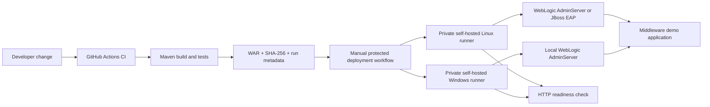

# Enterprise Middleware DevOps Lab

A Java 11 web application and deployment lab for Oracle WebLogic Server 14.1.1 and Red Hat JBoss EAP 7.4. The repository demonstrates building one immutable WAR, validating it, deploying it through vendor administration interfaces, checking application health, and selecting a verified artifact for rollback.

## Architecture



CI builds and tests the application, validates WAR structure, and publishes the WAR with a checksum. The manual deployment workflow accepts a successful CI run ID, verifies its provenance, downloads that run's artifact, validates its digest, and runs a selected deployment script on a private runner. GitHub Environment approvals and secrets are configured in repository settings. Deployments default to dry-run; a human explicitly selects a live action.

## Repository layout

The Windows WebLogic path is implemented by `scripts/deploy-weblogic.ps1`, tested by `tests/test-deploy-weblogic.ps1`, and dispatched through `.github/workflows/deploy-weblogic-windows.yml`. Existing Linux Bash deployment remains in place.

- `middleware-demo/` — Java 11 Servlet application, Maven build, and application-level instructions.
- `scripts/` — shared validation/logging, WebLogic and JBoss deployment, health check, WAR validator, rollback, and CI artifact provenance verifier.
- `config/` — non-secret DEV and TEST configuration examples. Replace placeholders with environment-scoped GitHub variables or protected local copies.
- `tests/` — Python unit tests and Bash integration-style tests using command stubs; no middleware is contacted.
- `docs/` — platform deployment guides, CI/CD and setup instructions, and an interview walkthrough.
- `.github/workflows/ci.yml` — build, test, package, and publish the immutable release artifact.
- `.github/workflows/deploy-middleware.yml` — manually triggered, environment-gated deployment workflow.
- `.github/workflows/deploy-weblogic-windows.yml` — Windows WebLogic dry-run on GitHub-hosted Windows and main-only live deployment on the protected local runner.

## Build and validate locally

Requirements: Java 11, Maven, Python 3, and Bash. From the repository root:

```bash
mvn --batch-mode -f middleware-demo/pom.xml clean verify
python3 -m unittest discover -s tests -p 'test_*.py' -v
bash -n scripts/*.sh tests/test_deployment_validation.sh
bash tests/test_deployment_validation.sh
powershell.exe -NoProfile -ExecutionPolicy Bypass -File tests/test-deploy-weblogic.ps1
```

The build produces `middleware-demo/target/middleware-demo.war`. The app exposes `/api/hello`, `/health`, and `/api/version` beneath its deployed context root. It uses the `javax.servlet` API for the stated middleware baseline. Tests use a local HTTP server and stub administration commands; they do not prove compatibility with an installed or configured middleware domain.

## Deployment flow

1. CI builds/tests once and stores the WAR, SHA-256 checksum, and build metadata as a GitHub artifact.
2. Configure the `DEV` and `TEST` GitHub Environments, add environment-scoped variables/secrets, and provision the appropriate Linux or Windows self-hosted runner on a private management network.
3. Dispatch **Manual Middleware Deployment** from `main` for the existing Linux path. For Windows WebLogic, dispatch **Manual WebLogic Windows Deployment**; hosted Windows validates the artifact and dry-run, and live deployment is restricted to `main` on the protected local Windows runner.
4. Review the workflow summary and server logs. Promote the same run/artifact digest to TEST after its environment approval.
5. For recovery, choose the known-good successful CI run and explicitly confirm rollback. The workflow verifies provenance, artifact checksum, and WAR contents before invoking rollback.

## Windows WebLogic deployment

Use **Manual WebLogic Windows Deployment** from `main` to deploy, redeploy, or roll back on the configured WebLogic host. It only accepts a manually selected successful CI run. The hosted Windows validation job verifies run provenance, SHA-256, WAR structure, and PowerShell dry-run behavior without middleware access. Live deployment runs with `dry_run=false`, after the DEV environment gate, on a self-hosted runner with labels `self-hosted`, `windows`, `x64`, and `middleware-devops`.

Provision that runner on the WebLogic machine because the configured admin and health URLs use `localhost`. The script uses Oracle JDK 11 at `C:\Program Files\Java\jdk-11.0.33.1`, WebLogic `WL_HOME` at `C:\Oracle\Middleware\Oracle_Home\wlserver`, target `AdminServer`, and app `middleware-demo`. Create WLST user config/key files for the deployment identity and store them outside the repository. Set the DEV environment variables `WEBLOGIC_USER_CONFIG_FILE` and `WEBLOGIC_USER_KEY_FILE` to those protected paths; ensure the runner service account can read them. The PowerShell script rejects credential files inside the checkout and ACLs that grant access to Everyone, Authenticated Users, or BUILTIN Users. Never store a password in workflow YAML or repository configuration.

The workflow uses `weblogic.Deployer` for application inventory and deploy/redeploy, checks its native process exit code, verifies the selected artifact digest, then retries `http://localhost:7001/middleware-demo/health` until it receives HTTP 200 with `{"status":"UP"}` or times out. Rollback verifies the same SHA-256 and uses `-redeploy` for the existing application. `t3://localhost` is appropriate only for this local trusted connection; use TLS (`t3s`) and appropriate trust configuration if management traffic crosses a host or network boundary.

See [deployment automation and workflow setup](docs/middleware-deployment-automation.md), [WebLogic guide](docs/weblogic-guide.md), [JBoss EAP guide](docs/jboss-guide.md), and the [interview walkthrough](docs/interview-walkthrough.md).

Live deployment requires supported middleware installations, valid administration client libraries, approved deployment credentials, network access, and correctly configured environment-specific targets. No middleware installation or successful live deployment is included in this lab's local validation.
