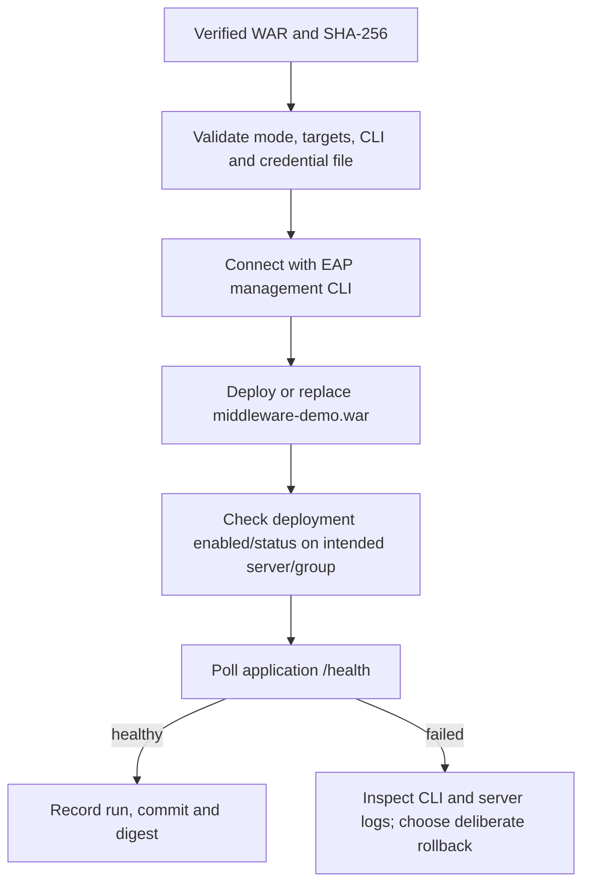

# Red Hat JBoss EAP 7.4 deployment guide

This guide explains the lab's JBoss EAP 7.4 path. It assumes an installation and management model already exist; it does not install, configure, or start EAP.

## Choose the management model

EAP standalone mode runs one server process with its own configuration and deployments. Use it when the environment intentionally manages instances independently. Domain mode uses a Domain Controller to coordinate host controllers and server groups. A deployment is assigned to one or more named server groups, so the `JBOSS_SERVER_GROUPS` value must reflect the actual domain topology. A server group is an administrative grouping and does not itself guarantee that every server is healthy.

The workflow's `JBOSS_MODE` must match the installation. In standalone mode, the CLI connects to a controller and deploys to that server. In domain mode, it applies the deployment to the configured server group(s) and checks the enabled status for those groups. Keep the management interface on a private network accessible to the controlled runner only.

## CLI and authentication

The script uses the EAP-provided `jboss-cli.sh`, never a guessed system path. Set `JBOSS_HOME` and optionally `JBOSS_CLI` to paths on the deployment runner. Configure `JBOSS_CONTROLLER`, mode, and server groups explicitly. The command uses the CLI deployment management operation and follows it with `deployment info` status checks before checking application health.

Authentication and TLS are configured through a protected Elytron `wildfly-config.xml` referenced by `JBOSS_WILDFLY_CONFIG`. Provision it from approved secret material; prefer Elytron credential stores or another organization-approved secret integration instead of clear-text passwords. Protect the file, ensure TLS trust matches the management endpoint, and grant only deployment permissions to the account.

## Deployment flow



Typical usage:

```bash
bash scripts/deploy-jboss.sh config/dev.env middleware-demo/target/middleware-demo.war --dry-run
bash scripts/deploy-jboss.sh config/dev.env middleware-demo/target/middleware-demo.war
```

The script uses `--force` to replace a deployment with the configured runtime name. Rollback verifies a supplied known-good archive against its SHA-256 and sends it through the same JBoss deployment path. The operator must confirm the selected artifact is the correct environment's last-known-good release in the GitHub workflow.

## Diagnose systematically

1. **Scope:** identify environment, controller, standalone/domain mode, intended server groups, run ID, and artifact digest.
2. **Artifact/config:** verify WAR checksum/structure, runtime name, config values, and absence of placeholders.
3. **Runner and connectivity:** check the configured CLI file exists, the EAP client runtime works, DNS/routing and firewall allow management access, and TLS trust is valid.
4. **Authentication:** inspect CLI authentication errors and Elytron client configuration without printing credentials.
5. **Management state:** query deployment info using the installed EAP CLI and check enabled/status values for each intended server or group. In domain mode inspect host/server status as well.
6. **Application health:** check context root, health URL, listener, and response body. Compare app startup exceptions and deployment messages in server logs.
7. **Recovery:** preserve evidence, select a trusted prior artifact, verify its checksum and environment, then confirm and execute rollback.

Common failures include a controller URL/port mismatch, unsupported client config, missing management role, CLI authentication or TLS errors, typo in a server group, deployment enabled on only part of the intended domain, port/context mismatch, and application startup errors. Correlate CLI output with the EAP server logs and platform monitoring; do not infer whole-domain health from a single successful CLI command.

## Local validation boundary

Automated tests use a fake `jboss-cli.sh`; they verify argument and status handling without connecting to EAP. They cannot prove the EAP 7.4 CLI syntax against a specific patch level, domain behavior, authentication, TLS, app compatibility, or server/group readiness. Verify these in an authorized DEV environment before live use.
