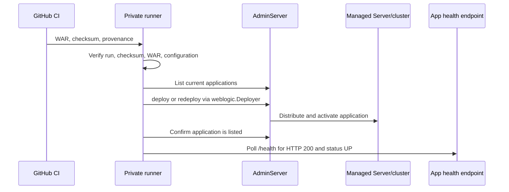

# Oracle WebLogic Server 14.1.1 deployment guide

This guide describes the lab's WebLogic deployment path and the server concepts needed to operate it. It does not install or configure a WebLogic domain. Use your organization's supported installation, security, and change procedures.

## Domain model

A WebLogic domain is the administrative boundary containing an AdminServer, configuration, and one or more Managed Servers. The AdminServer hosts the administration service and configuration model. Applications normally run on Managed Servers, which may be grouped into a cluster for load balancing and failover. Node Manager is commonly used to start, stop, and monitor server processes; it is separate from the application deployment command. The `WEBLOGIC_TARGETS` value must identify the intended server or cluster in the actual domain. The deployment script does not discover or invent targets.

The runner connects to the AdminServer management URL, while the application health check connects to the application URL. These are separate network paths and often use separate DNS names, ports, TLS certificates, and firewall rules. Keep administration ports on a private management network and restrict them to the deployment runner.

## Client and credentials

The script invokes `weblogic.Deployer` from the WebLogic 14.1.1 client libraries. Set `WEBLOGIC_CLASSPATH` to the actual classpath for the installed client. The target must be a deployed server or cluster name accepted by the domain. The app name is `APP_NAME` and the WAR is supplied as an explicit positional argument.

Use the WebLogic user config and key files supported by the deployer (`-userconfigfile` and `-userkeyfile`). Generate the pair using the approved WLST procedure for the target environment and store it outside source control. Protect both files and make them readable only by the deployment identity. The automation never takes an administrator password as a command-line argument. Grant the identity only the deployment permissions needed for the selected target.

### Windows PowerShell path

`scripts/deploy-weblogic.ps1` is the Windows equivalent for the configured local domain. It uses Oracle JDK 11 at `C:\Program Files\Java\jdk-11.0.33.1` and `WL_HOME` at `C:\Oracle\Middleware\Oracle_Home\wlserver`. Before launching Java, it calls WebLogic's `server\bin\setWLSEnv.cmd` in a temporary command file to obtain the supported client classpath. It invokes `weblogic.Deployer` with `-userconfigfile` and `-userkeyfile`, passes no password on the command line, and rejects credential files under the checkout or files with broad-user ACLs. Oracle's 14.1.1 guide describes `setWLSEnv.cmd` as a way to configure the WebLogic classpath and JDK environment ([Deployer command reference](https://docs.oracle.com/en/middleware/standalone/weblogic-server/14.1.1.0/depgd/wldeployer.html)).

The Windows manual workflow verifies the selected CI run, artifact checksum, and WAR structure on a GitHub-hosted Windows runner first. That hosted job runs the script with `-DryRun`, so it does not connect to WebLogic and does not need credential files. Live execution is only possible from a manual dispatch of `main`, after the `DEV` Environment gate, on the self-hosted labels `[self-hosted, windows, x64, middleware-devops]`. The runner must be on the WebLogic host because the provided Admin URL and health endpoint use `localhost`. Configure the `DEV` Environment variables `WEBLOGIC_USER_CONFIG_FILE` and `WEBLOGIC_USER_KEY_FILE` with paths outside the repository. The runner service identity must be able to read both files; ACLs must exclude Everyone, Authenticated Users, and BUILTIN Users.

The supported operations are `deploy` (only when the app is not already registered), `redeploy` (only for an existing app), and `rollback` (also redeploys the already verified prior WAR). Every operation requires an expected 64-character SHA-256. The workflow verifies provenance and digest, while the script recomputes the digest before taking action. On success, it checks the native process exit code, confirms `middleware-demo` appears in `-listapps`, and retries the configured health endpoint with bounded request timeouts.

## Deployment lifecycle



The script checks whether the application exists before choosing the requested operation: `deploy` is for a first installation; `redeploy` expects an existing application. It verifies the application appears after the command and then performs the application readiness check. A successful deployer command alone is not proof that every managed server is serving healthy traffic.

Example after configuring a protected local environment file and credentials:

```bash
bash scripts/deploy-weblogic.sh config/dev.env middleware-demo/target/middleware-demo.war deploy --dry-run
bash scripts/deploy-weblogic.sh config/dev.env middleware-demo/target/middleware-demo.war deploy
```

For a real update of an existing application, use `redeploy`. Rollback always redeploys the supplied known-good WAR and first requires its retained SHA-256 digest. If the deployment has been removed, inspect the domain and restore it through an approved first-install procedure.

## Failure diagnosis

Use the workflow run ID, artifact digest, deployment script log, deployer output, AdminServer log, Managed Server logs, and health response as a single evidence trail. Check in this order:

1. **Artifact/configuration:** verify the WAR checksum, ZIP structure, target name, AdminServer URL, and that placeholders were replaced.
2. **Runner/runtime:** confirm the Java runtime and `WEBLOGIC_CLASSPATH` are from the compatible installation; inspect the logged command output for class loading or TLS errors.
3. **Connectivity/authentication:** verify runner DNS/routing/firewall to the management URL and TLS trust; confirm user config/key pair permissions and validity. Do not test by printing secrets.
4. **Target/application state:** inspect the domain's current application targets and deployment state; correlate deployer output with AdminServer and target Managed Server logs.
5. **Readiness:** confirm the deployed context root, app URL, HTTP status and JSON payload. A 404 often indicates a wrong context path; a timeout can indicate routing, listener, or app startup trouble.
6. **Recovery:** only after identifying the intended last-known-good release, select its CI run and digest and invoke confirmed rollback. Keep logs and change records.

Common operational risks include deploying to the wrong target, a partially unhealthy cluster, incompatible application APIs, stuck deployment tasks, and a successful admin operation followed by a failing app health check. Verify target membership and health across all cluster members under the site's release procedure. The lab's single HTTP health URL is a basic readiness signal, not a full production canary or transaction test.

## Local validation boundary

Stub-based tests validate command construction and expected control flow. They cannot validate an actual WebLogic installation, AdminServer connectivity, authentication, domain target syntax, application compatibility, cluster behavior, or production TLS. Perform a controlled deployment in an authorized DEV domain before promoting the automation.
